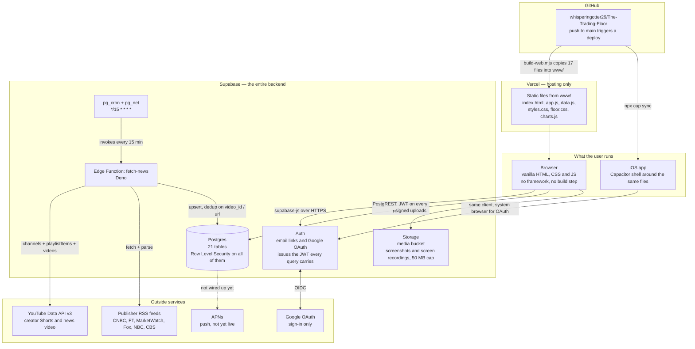

# The Trading Floor — how the backend works

A note on one thing before the diagram: **Google does not host any of this.**
Google appears only as a sign-in provider (OAuth) and as the owner of the
YouTube Data API that creator clips and news video come from. The site itself is
hosted by **Vercel**, and everything stateful lives in **Supabase**. It is worth
being precise about that, because "Google Cloud" would describe a different
system from the one that is actually running.

---

## The shape of it

---

## Why the database does the deciding

Almost every rule in this product is enforced in Postgres rather than in the
page, because the page is just JavaScript on someone else's computer and can be
edited in a console. The client decides what to *draw*; the database decides what
the client is *allowed to see*.

Concretely:

| Rule | Where it actually lives |
|---|---|
| A private account's trades are hidden | `can_view(uuid)`, used by the RLS policy on `posts` |
| Following a private account needs approval | `follows_set_status` trigger + the `follow or request` policy |
| A hidden P/L is never sent to anyone else | `posts_feed` view returns `null` for `pnl` |
| Blocked people cannot see each other | `posts_feed` filters blocks both directions |
| Comments can be turned off | policy on `comments`, not just a hidden form |
| Profanity in handles and badges | `name_violation()` trigger, `SECURITY DEFINER` |
| News ranking and topic tagging | `news_topics()`, `my_news_topics()`, `news_feed` view |

The pattern throughout: a **view** shapes what a row looks like to the person
reading it, an **RLS policy** decides whether they get the row at all, and a
**trigger** stops the client sending something it shouldn't.

## Views the client reads

The app almost never selects from a base table. It reads views, which already
have the joins, counts and per-viewer filtering baked in:

- `posts_feed` — posts + author + like/comment counts, minus blocked people, with
  P/L masked when the author keeps it private
- `profiles_stats` — profile + follower/following/pending counts
- `clips_feed`, `clip_comments_list` — creator clips and their comments
- `news_feed` — headlines with `topics`, `is_market`, `matches_me` and `rank_at`
- `strategies_list` — strategies + author + follower and fork counts
- `follow_requests` — pending follows addressed to you

## The ingest

`fetch-news` is the only server-side code in the project. Every 15 minutes
`pg_cron` calls it through `pg_net`, and it:

1. reads `news_sources` for what to pull
2. for creators, resolves each channel's real uploads playlist via
   `channels?part=contentDetails` — the common `UC` → `UU` shortcut is not
   reliable for every channel — then walks `playlistItems` and `videos` to get
   durations
3. keeps only Shorts for creators (duration ≤ 180s → `is_short`)
4. fetches and parses publisher RSS for headlines
5. upserts into `news_items`, where the `news_items_set_topics` trigger tags each
   row by topic as it lands

The YouTube API key lives in Edge Function secrets. It is never in the client.

## What is public on purpose

`SUPABASE_KEY` in `data.js` is the publishable key and is meant to be public.
It identifies the project, not the user. What any given request may read or write
is decided by the JWT that Auth issued and the RLS policies on each table — not
by possession of that key.

## Not yet wired up

- **APNs.** `push_tokens` collects device tokens and the app registers for them,
  but nothing sends a notification yet; that needs an Apple Developer account.
- **Sign in with Apple.** Required by App Store review because Google sign-in is
  offered. Same blocker.
